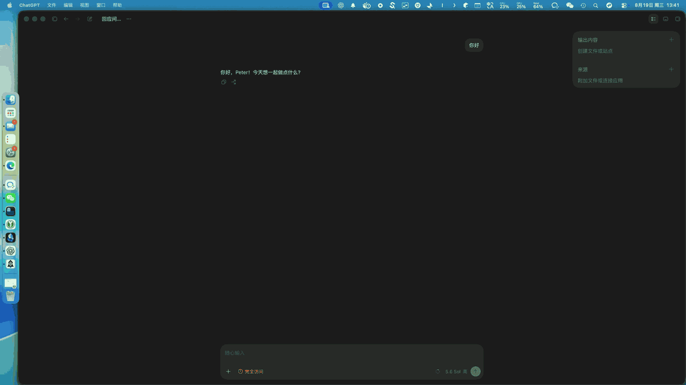
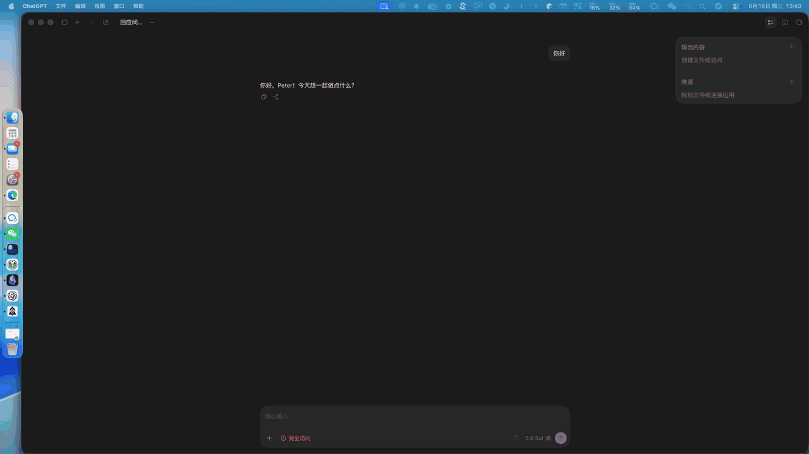

<p align="center">
  
</p>

<h1 align="center">CueDex</h1>

<p align="center"><strong>Know when your coding assistant is done, even when you are looking elsewhere.</strong></p>

<p align="center">
  A lightweight native macOS utility that uses screen-edge glow, sound, or speech<br>
  when the main Codex or OpenCode session finishes responding.
</p>

<p align="center">
  <a href="README.md">English</a> · <a href="README.zh-CN.md">简体中文</a>
</p>

<p align="center">
  <a href="https://github.com/def-peter/CueDex/releases/latest"></a>
  <a href="https://github.com/def-peter/CueDex/releases"></a>
  
  <a href="https://github.com/def-peter/CueDex/actions/workflows/release.yml"></a>
  <a href="https://github.com/def-peter/CueDex/stargazers"></a>
  <a href="LICENSE"></a>
</p>

CueDex is useful when a coding task takes long enough for you to switch to another window or step away. It listens for completion events locally and gives you a visible or audible cue without persisting or sending the conversation.

## ✨ See It in Action

<table>
  <tr>
    <td align="center" width="50%">
      
      <br><sub><strong>Breathing glow</strong> · one color, soft rise and fade</sub>
    </td>
    <td align="center" width="50%">
      
      <br><sub><strong>Two-color flash</strong> · alternating edge light, red and blue by default</sub>
    </td>
  </tr>
</table>

The recordings show CueDex running around a real macOS Codex workspace. Colors and animation are configurable; glow now uses fixed 100% intensity and a 3-second duration.

## 🔔 Features

- 🎯 Main-agent completion events through the Codex `Stop` lifecycle hook; subagent completions are ignored
- 🔌 Optional global plugin for stable OpenCode 2.x (>= 2.1.1, < 3.0.0), with independent Codex/OpenCode cue profiles; real reminders confirmed in the local CLI and OpenChamber 2.5.0 on 2.1.1
- 🌈 GPU-driven monochrome breathing glow or two-color emergency-style edge flash across every connected display
- 🎛️ Per-source colors, animations, macOS sounds, and imported audio; sound and speech follow system volume
- 🗣️ Custom spoken messages and system voices through Apple's native `AVSpeechSynthesizer`
- 🌙 Pause, quiet hours, launch at login, and one-click cue previews
- 🌐 Runtime Simplified Chinese and English switching, with Chinese as the default
- 🔄 In-app update downloads with SHA-256 verification and installer mounting, plus lightweight daily notifications and manual checks
- 🔒 Event-driven local processing with no polling, analytics, or prompt/response storage

## 📥 Install

**Requirements:** macOS 14 or later, on either Intel or Apple silicon.

1. Download the correct DMG from the [latest GitHub Release](https://github.com/def-peter/CueDex/releases/latest): `arm64` for Apple silicon (M1 or later), or `x86_64` for Intel.
2. Open the DMG and move `CueDex.app` to `/Applications`.
3. Launch CueDex and enable the desired integration below. Integrations are not enabled automatically.

> [!IMPORTANT]
> CueDex is ad-hoc signed but is not notarized because it does not currently use
> a paid Apple Developer ID certificate. macOS may block the first launch or say
> that it cannot verify the developer. This is an expected Gatekeeper warning,
> not a malware detection. Open **System Settings > Privacy & Security**, find
> the CueDex message, choose **Open Anyway**, and confirm.

**Updating:** When an update is available, click **Download Update** to download the matching DMG for your Mac (`arm64` or `x86_64`) and verify its size and SHA-256 checksum in the background. After verification, click **Open Installer** to mount the DMG, then quit the running CueDex and drag the new app into `/Applications` to replace it. CueDex does not auto-replace files, elevate privileges, or remove quarantine flags. You can also view the release page to download manually at any time.

## 🔌 Connect to Codex

**CueDex installs the hook for you; you do not need to edit JSON or copy a command manually.** Installing CueDex alone does not enable the integration. Codex's trust confirmation is a separate user action, not a manual configuration step.

1. Open CueDex and select **General > Codex > Enable Integration**. Review the target file and confirm. CueDex installs its local helper and adds its `Stop` handler to `~/.codex/hooks.json`, preserving other hooks and any unrelated `notify` command. If `CODEX_HOME` is set for CueDex, the hooks file is under that directory instead.
2. Open **Codex Settings > Hooks**. Look under the **`Stop` event** for the command containing **`cuedex-notify`**, then review and trust it. The current hook has no separate display name; do not rely on seeing a row named “CueDex”. Its default command points to:

   ```text
   ~/Library/Application Support/CueDex/bin/cuedex-notify
   ```

   CueDex also displays the actual **Hook event** and **Hook command** in General settings so you can match them. It cannot confirm or grant Codex's hook trust on your behalf.
3. If the hook is missing, finish active work, restart Codex, and check again. CueDex does not restart Codex for you.
4. Complete a **new main-session request** and check **Last completion received** in CueDex. **Configured** means the hook is installed, not that it is trusted or connected. **Test Codex** only previews local effects and is not an integration test.

Once trusted and loaded, CueDex stays in the menu bar and responds only when the main agent finishes with a new assistant message. Disabling integration removes CueDex's own hook while preserving other hooks and your saved cue settings.

If another Codex `Stop` hook blocks completion and asks the agent to continue, CueDex cannot guarantee that its cue waits for that continuation.

## 🔌 Connect to OpenCode

> [!IMPORTANT]
> **Installing CueDex alone does not enable OpenCode reminders.** You must explicitly enable the integration, which installs a plugin into OpenCode, then reload the OpenCode service used by your client. No manual JSON edits, MCP setup, or API keys are required.

1. Make sure the **actual local OpenCode backend is a supported stable 2.x release (>= 2.1.1 and < 3.0.0)**. Prereleases, versions outside this range, remote servers, SSH, and containers are not supported. CueDex's **Detected CLI version** checks a local executable, not necessarily the backend your client uses.
2. In CueDex, select **General > OpenCode > Enable Integration**. Review the plugin path and confirm installation. CueDex writes its managed global plugin to `~/.config/opencode/plugins/cuedex.js`, applying to local projects. It preserves other plugins; disabling integration removes only CueDex's managed plugin and preserves your cue settings.
3. Finish active work, then reload the OpenCode service used by your CLI or client. If reloading the client does not load the plugin, restart its OpenCode backend yourself. CueDex does not restart tools or services for you.
4. Start a **new request in a main session**, let it finish successfully, and check **Last completion received** in CueDex. **Configured** only means the plugin is installed, not that event delivery has been verified. **Test OpenCode** previews effects locally; it does not test the integration.

**Updating an existing integration:** When launched, release builds of CueDex automatically refresh an already-enabled managed OpenCode plugin to the latest bridge template while preserving the existing installation generation. CueDex does not auto-enable integration, never touches unowned files, and skips writing when the script is unchanged. If writing the file triggers an OpenCode plugin reload during an active request, that in-flight turn may skip reminding. After upgrading OpenCode, finish active work and reload its service so the updated bridge takes effect.

### Using OpenChamber

OpenChamber can run its own bundled OpenCode backend, even when `opencode --version` in Terminal reports a supported 2.x version. In the observed OpenChamber **2.5.0** installation, the bundled backend was **2.0.32**, which CueDex's plugin deliberately skips.

1. In OpenChamber, open **Settings > OpenChamber > General > OpenCode CLI**.
2. Set **OpenCode binary path** to the absolute path of your installed **supported 2.x (>= 2.1.1)** executable. Use `command -v opencode` in Terminal to find it and `opencode --version` to check its version. For example, this machine uses `/usr/local/bin/opencode`; your path may differ.
3. Finish active work and click **Save + reload**, then complete a new main-session request to verify the reminder.

The instance selector's **Local · 127.0.0.1:…** address identifies the OpenChamber server, not the OpenCode executable or its version. Changing that address is not the fix.

The plugin targets successful main-session responses, not child sessions, failures, cancellations, or permission/input waits. A request already running when the plugin loads is deliberately skipped. Cue settings remain editable when integration is disabled, and preview buttons do not verify connectivity.

**Validation boundary:** on October 21, 2026, the user confirmed real reminders from the local OpenCode CLI and, after switching its backend to 2.1.1 and reloading, OpenChamber 2.5.0. Static verification of npm packages 2.1.1 and 2.1.3 confirmed plugin, session, and event compatibility, but real user sessions on 2.1.3 have not yet undergone live acceptance testing. This does not establish support for versions outside stable 2.x (>= 2.1.1, < 3.0.0) or complete all multi-effect timing and Codex Stop-hook boundary checks. See [the design and verification record](docs/design/opencode-support.md).

## ⚙️ How It Works

Codex invokes a small local helper for the main agent's `Stop` event. OpenCode uses a global V2 plugin to observe execution and primary-step lifecycle events. Both write metadata-only local event files under `~/Library/Application Support/CueDex` and wake the app. A dispatch file-system source consumes fresh events without polling. CueDex deduplicates delivery, routes it to the matching source profile, and queues cues without interrupting playback. Events older than 60 seconds are discarded; pause and quiet hours clear pending cues without replaying them later.

Prompt and response content are never persisted or sent anywhere. CueDex only accesses the network to check the GitHub Releases API and to download official release assets when you choose to update.

## 🛠️ Development

Build and launch the Debug app with the Codex Run action or:

```bash
./script/build_and_run.sh
```

Run unit and UI tests:

```bash
xcodebuild -project CueDex.xcodeproj -scheme CueDex \
  -destination 'platform=macOS' \
  -derivedDataPath .build/TestDerivedData \
  CODE_SIGNING_ALLOWED=NO test
```

## 📦 Packaging and Release

Build an unsigned, universal DMG for Intel and Apple silicon:

```bash
./script/package_unsigned.sh
```

Or build one architecture:

```bash
./script/package_unsigned.sh --arch x86_64
./script/package_unsigned.sh --arch arm64
```

To publish a new version from `main`:

```bash
./script/release.sh
```

The release script updates the version and build number, creates the release commit and tag, and pushes them to GitHub. GitHub Actions builds separate `x86_64` and `arm64` DMGs, verifies their SHA-256 checksums, and attaches all artifacts to the Release.

Use `./script/release.sh --dry-run --version <x.y.z>` to preview the release without modifying files, commits, tags, or remotes.

## 💬 Feedback

Bug reports and feature ideas are welcome in [GitHub Issues](https://github.com/def-peter/CueDex/issues), or by email at [guanzhen.li@foxmail.com](mailto:guanzhen.li@foxmail.com).

## ⭐ Star History

If CueDex is useful to you, a star helps more people find it.

<a href="https://www.star-history.com/?repos=def-peter%2FCueDex&type=date&legend=top-left">
  <picture>
    <source media="(prefers-color-scheme: dark)" srcset="https://api.star-history.com/chart?repos=def-peter/CueDex&type=date&theme=dark&legend=top-left&sealed_token=5nuVWzx-WQUx7nvob4_ku4QGR4Plyxbd64fWgjA7yRwk_5fr3VhB0fYSXvp3RY6VIrCGfIXj0osJ56k3LY9ALFwAFKIkIPEpdS3nsla21cmR7xmBLsyfhA">
    <source media="(prefers-color-scheme: light)" srcset="https://api.star-history.com/chart?repos=def-peter/CueDex&type=date&legend=top-left&sealed_token=5nuVWzx-WQUx7nvob4_ku4QGR4Plyxbd64fWgjA7yRwk_5fr3VhB0fYSXvp3RY6VIrCGfIXj0osJ56k3LY9ALFwAFKIkIPEpdS3nsla21cmR7xmBLsyfhA">
    
  </picture>
</a>

## 📄 License

Created by Peter Li. CueDex is available under the [MIT License](LICENSE).
